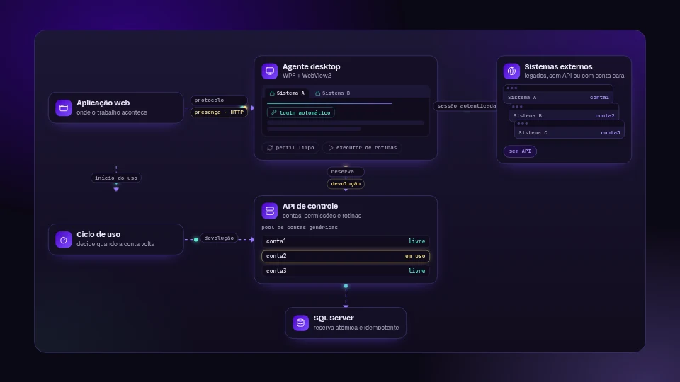
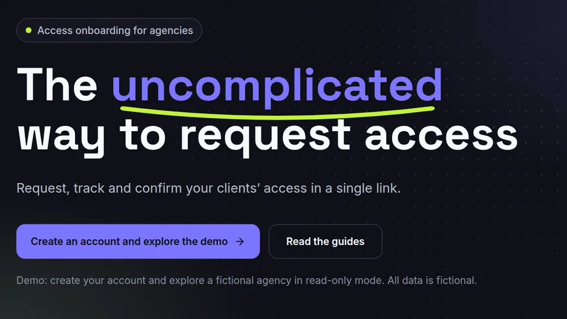
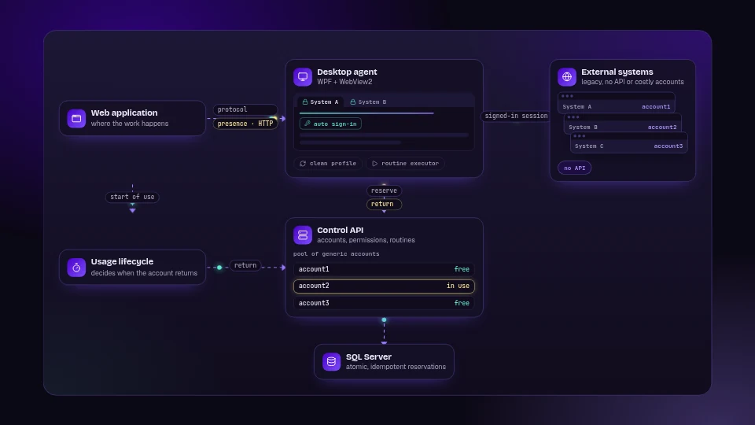

<h1>Bruno Anhezini</h1>

  
  

**PT** · [English below](#english)

Oi, eu sou o Bruno. Dev full stack de C#/.NET, Angular e SQL Server. Meu forte é backend, infra e manter as coisas de pé em produção.

Moro em Americana, SP, e estou aberto a vagas 100% remotas, no Brasil e no exterior. Uso Claude Code, Codex, MCP e agentes de IA de forma intensa, com revisão e validação técnica do que eles entregam.

Os projetos e artigos ficam no meu portfólio, o **[Brskt Space](https://brskt-dev.github.io/brskt-space/pt/)**. Dúvida, ideia ou papo sobre vaga: me chama no [LinkedIn](https://www.linkedin.com/in/brskt-dev/).

### No Brskt Space agora

<table>
  <tr>
    <td width="50%" valign="top">
      
       PROJETO 
      <a href="https://brskt-dev.github.io/brskt-space/pt/projetos/conta-comigo/"><b>Conta Comigo</b></a> 
      Checklist guiado para agências de marketing coletarem os acessos dos clientes. A agência monta, envia um link e acompanha item a item; o cliente preenche sem criar conta.
       <a href="https://contacomigo-demo.vercel.app">Abrir a demo</a>
    </td>
    <td width="50%" valign="top">
      
       ARTIGO 
      <a href="https://brskt-dev.github.io/brskt-space/pt/artigos/interface-como-integracao/"><b>Quando a interface vira integração: de rotinas gravadas a agentes de IA</b></a> 
      Como dar acesso a sistemas web legados sem API, ou com contas caras demais para ter uma por pessoa. E como eu levaria essa ideia para agentes de IA.
    </td>
  </tr>
</table>

### Com o que eu trabalho

- **Desenvolvimento:** C#, .NET 8/9, ASP.NET Core, Angular, TypeScript
- **Backend e arquitetura:** APIs REST, microsserviços, workers, modelagem de domínio, autenticação e autorização
- **Dados e mensageria:** SQL Server, Redis, Kafka, CDC e Debezium
- **Tempo real:** WebSockets e Centrifugo
- **Infra e entrega:** Docker Swarm, Traefik, Portainer, GitHub Actions, Linux, Cloudflare
- **Agentes de código:** Claude Code, Codex, MCP, fluxos multiagente
- **Também já passei por:** Delphi, WPF, WebView2, Playwright, ESP32, nRF52 e firmware embarcado

Trajetória completa em [Sobre](https://brskt-dev.github.io/brskt-space/pt/sobre/).

---

<h2 id="english">English</h2>

Hi, I’m Bruno. Full-stack dev working with C#/.NET, Angular and SQL Server. My strengths are backend, infra and keeping things running in production.

I live in Americana, São Paulo, Brazil, and I’m open to 100% remote roles, in Brazil and abroad, working from Brazil. I use Claude Code, Codex, MCP and AI agents heavily, with technical review and validation of what they deliver.

My projects and articles live on my portfolio, **[Brskt Space](https://brskt-dev.github.io/brskt-space/en/)**. Questions, ideas or a role to talk about: reach me on [LinkedIn](https://www.linkedin.com/in/brskt-dev/).

### On Brskt Space now

<table>
  <tr>
    <td width="50%" valign="top">
      
       PROJECT 
      <a href="https://brskt-dev.github.io/brskt-space/en/projects/conta-comigo/"><b>Conta Comigo</b></a> 
      A guided checklist for marketing agencies to collect access from their clients. The agency builds it, sends a link and tracks it item by item; the client fills it in without creating an account.
       <a href="https://contacomigo-demo.vercel.app">Open the demo</a>
    </td>
    <td width="50%" valign="top">
      
       ARTICLE 
      <a href="https://brskt-dev.github.io/brskt-space/en/articles/interface-como-integracao/"><b>When the UI becomes the integration: from recorded routines to AI agents</b></a> 
      How to give people access to legacy web systems with no API, or with accounts too expensive to have one per person. And how I’d take the idea toward AI agents.
    </td>
  </tr>
</table>

### What I work with

- **Development:** C#, .NET 8/9, ASP.NET Core, Angular, TypeScript
- **Backend and architecture:** REST APIs, microservices, workers, domain modeling, authentication and authorization
- **Data and messaging:** SQL Server, Redis, Kafka, CDC and Debezium
- **Real time:** WebSockets and Centrifugo
- **Infra and delivery:** Docker Swarm, Traefik, Portainer, GitHub Actions, Linux, Cloudflare
- **Coding agents:** Claude Code, Codex, MCP, multi-agent workflows
- **I’ve also worked with:** Delphi, WPF, WebView2, Playwright, ESP32, nRF52 and embedded firmware

Full background on [About](https://brskt-dev.github.io/brskt-space/en/about/).
